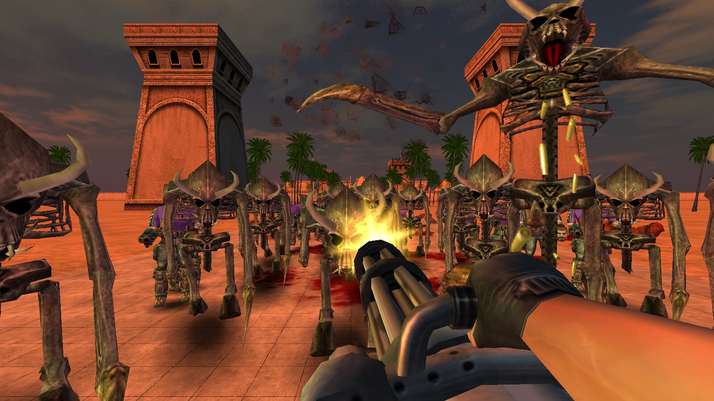
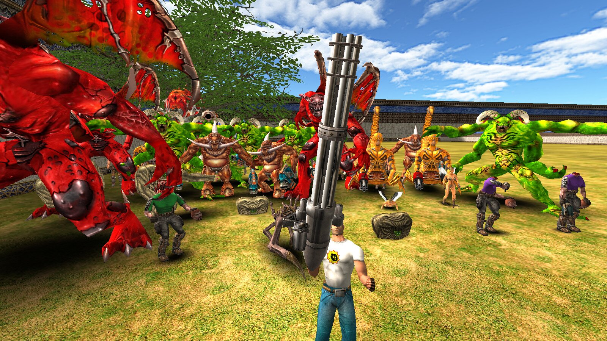
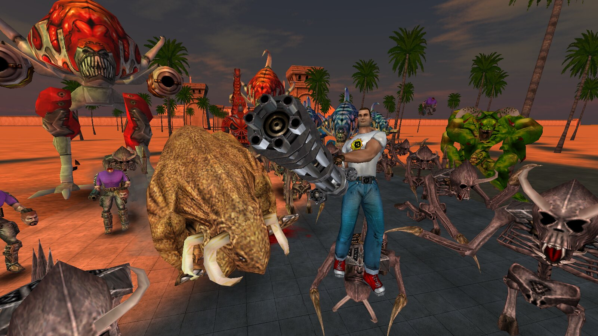
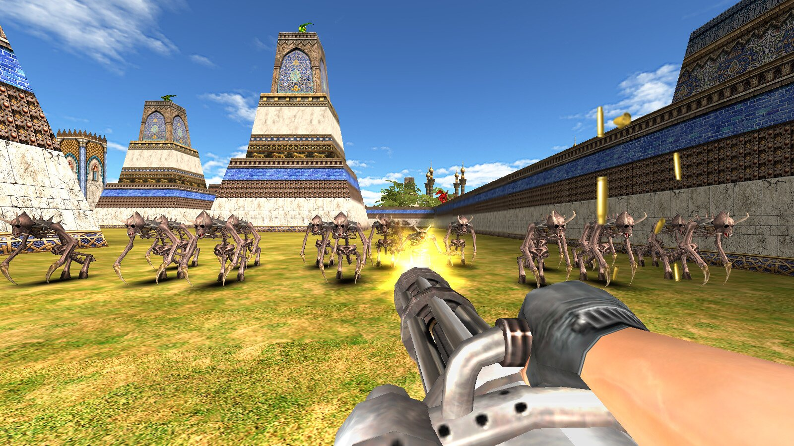
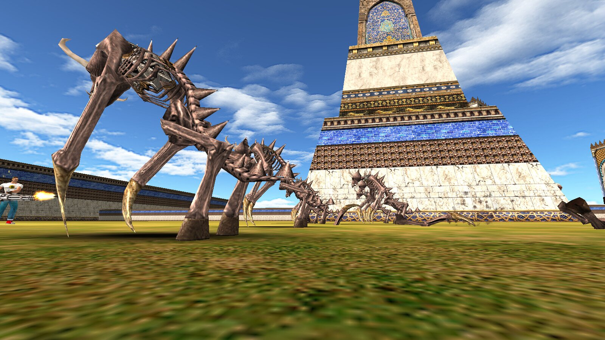
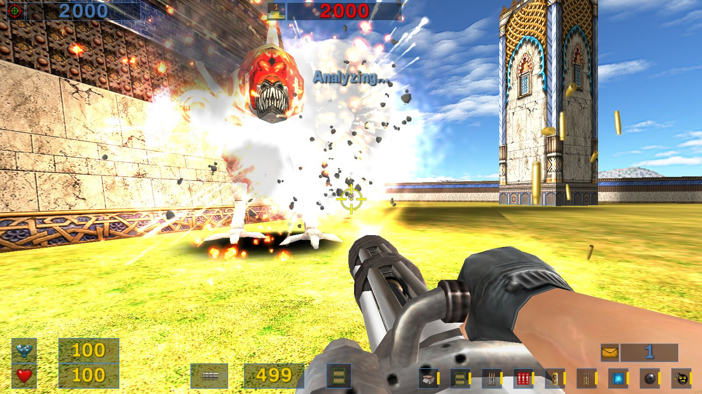
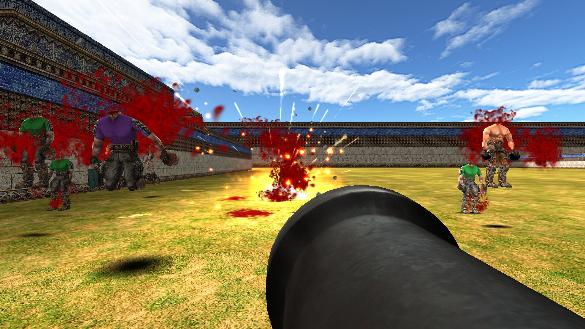
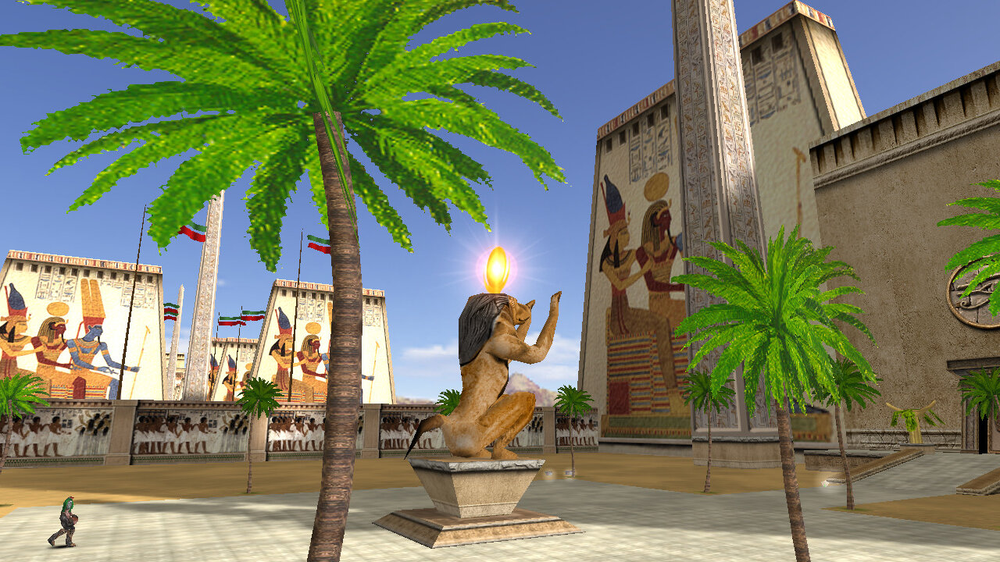
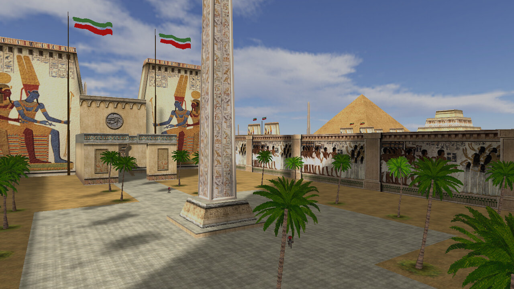

# Serious Sam: The First Encounter and The Second Encounter for iPhone (Serious Sam Classic)

Play **Serious Sam: The First Encounter** (2001) and **Serious Sam: The Second Encounter** (2002) on your iPhone, with touch controls made for them. Two free apps, **Sam FE** and **Sam SE**, unofficial builds of Croteam's open-source Serious Engine 1, by way of [SeriousSamClassic](https://github.com/tx00100xt/SeriousSamClassic).



**You need your own PC copy of the game. Game files are not included.** Buy *Serious Sam: The First Encounter* or *The Second Encounter* on [GOG](https://www.gog.com/en/game/serious_sam_the_first_encounter) ([The Second Encounter](https://www.gog.com/en/game/serious_sam_the_second_encounter)), the copy these apps were tested with, then copy its files to your iPhone. The Steam editions, *Serious Sam Classic: [The First Encounter](https://store.steampowered.com/app/41050/)* and *[The Second Encounter](https://store.steampowered.com/app/41060/)*, should have the same files but haven't been tried.

## Install

You need an iPhone with iOS 15 or newer. The apps aren't on the App Store, so you install them yourself ("sideloading"). Pick one way:

- **SideStore or AltStore (easiest).** On your iPhone, tap **[Add to SideStore](https://sithewok13-dev.github.io/serious-sam/#add-sidestore)** or **[Add to AltStore](https://sithewok13-dev.github.io/serious-sam/#add-altstore)**, then install **Sam FE** or **Sam SE** (or both) from there. Updates come the same way.
- **Sideloadly, Feather, Signulous or another signing tool.** Download `serioussam-ios.ipa` (The First Encounter) or `serioussamse-ios.ipa` (The Second Encounter) from the [latest release](https://github.com/sithewok13-dev/SeriousSamClassic/releases/latest) and install it with your tool.
- **The source by hand.** In SideStore, AltStore or Feather, go to *Sources*, tap **+**, and paste this address:

  ```
  https://raw.githubusercontent.com/sithewok13-dev/SeriousSamClassic/ios/altsource.json
  ```

Then open the app once (it says *Game data not found*, which is expected) and copy your game files into *Files > On My iPhone > Sam FE* (or *Sam SE*). The [release page](https://github.com/sithewok13-dev/SeriousSamClassic/releases/latest) says exactly which files, step by step, and explains every control.

AltStore here means AltStore Classic; AltStore PAL can't install these apps. The newest test build is the *iOS latest build* on the [releases page](https://github.com/sithewok13-dev/SeriousSamClassic/releases): it's rebuilt after every change, before anyone has tried it.

## Cool features

- **Touch controls made for Serious Sam:** a move stick wherever your left thumb lands, drag anywhere to look, and FIRE, JUMP, USE and CROUCH under your right thumb. LOOK sets how fast dragging turns (0.5x to 3x).
- **A weapon wheel:** slide off NEXT WPN or PREV WPN and every weapon you carry is laid out round your thumb, with its icon and ammo. In single player the game holds still while you pick.
- **CAMERA, with selfies:** tap for a photo, slide for a burst. Hold it for a **selfie**: up to 48 of the nearest enemies pose round Sam, frozen in moves from their own animations. Photos go straight to your Photos app.
- **Action Freeze:** slide CAMERA down and the fight stops mid-explosion; fly the camera round it and take your shot. Slide up for a **cinematic burst**, five photos as the camera sweeps round the action.
- **A cheat for relaxed play,** `sithewok`: god mode, endless ammo, flying, walking through walls, being caught when you fall into a pit, and a list of every level to jump to.
- **Tilt aiming** (gyro), if you want it: OFF, TOUCH (while a thumb is down) or ALWAYS.
- **60 or 120 frames a second,** drawn through ANGLE on Metal, Apple's modern graphics system.
- **Quick save and quick load** on a short hold, so a stray tap can't undo your progress.
- **Network games:** co-op, scorematch and fragmatch with friends on the same Wi-Fi (*SEARCH LAN* finds them), with the games' own multiplayer and the same touch controls.
- **A HUD that fits** notched and Dynamic Island screens, the iPhone keyboard for the game's text boxes, and sound even with the phone on silent.

<p>








</p>

*None of these pictures is from an iPhone, so they show no touch controls. They come from the same game code running on a computer, with the real game files: the selfies and Action Freeze were taken with this port's own camera code. The fights are in The First Encounter's Alley of Sphinxes and The Second Encounter's Persepolis, with the cheat on and the enemies brought together for the pictures; the two Karnak pictures are from The First Encounter's own fly-through demo.*

## Sorry about the bugs

This is an unofficial beta, and it has bugs. Thank you for trying it anyway. Back up your saves now and then (the release page says where they are).

**Multiplayer is the least tested part, and may not work for you.** So far it has been tested only on a computer, with the real games. It hasn't been tried between two iPhones, or an iPhone and a PC, yet. In ios-v0.3, a player who joined someone else's game couldn't look around at all; that's fixed in the test build and in ios-v0.4. Sorry if it lets you down: please tell us what happens if you try.

Found a bug? Please [report it here](https://github.com/sithewok13-dev/SeriousSamClassic/issues), not to the upstream SeriousSamClassic project. Say which app, which iPhone, and the build (hold MENU: it's under the tray, for example *build 41 · Nov 17*).

## Thanks

These apps stand on a lot of other people's work. Thank you to:

- **[Croteam](https://github.com/Croteam-official/Serious-Engine)**, for making Serious Sam, and for releasing Serious Engine 1's source code to everyone, under the GNU GPL v2, in 2016.
- **[tx00100xt](https://github.com/tx00100xt)**, who maintains **[SeriousSamClassic](https://github.com/tx00100xt/SeriousSamClassic)**, the cross-platform version this is forked from. It keeps both games building on Linux, the BSDs, macOS and more, and added widescreen support for the menus, NETRICSA and the HUD, which every iPhone screen needs.
- The people who first brought the engine beyond Windows, whose work SeriousSamClassic carries on: **[Ryan C. Gordon](https://github.com/icculus)** (the first Linux port), **[ptitSeb](https://github.com/ptitSeb)** (ARM and handheld ports, and **gl4es**, which these apps draw with), **[Daniel Gibson](https://github.com/DanielGibson)**, **[zcaliptium](https://github.com/zcaliptium)**, and every contributor in the [change log](https://github.com/sithewok13-dev/SeriousSamClassic/blob/ios/CHANGELOG.old).
- **[SDL](https://github.com/libsdl-org/SDL)**, **[ANGLE](https://github.com/google/angle)** and **[Xiph.Org](https://xiph.org/)** (Ogg Vorbis, for the music).

The iPhone parts (touch controls, camera, cheat, network fixes) are this fork's own, in the [`ios/` folder](https://github.com/sithewok13-dev/SeriousSamClassic/tree/ios/ios). Any bugs in them are ours, not theirs. Free software under the [GNU GPL v2](https://github.com/sithewok13-dev/SeriousSamClassic/blob/ios/LICENSE).

Not affiliated with or endorsed by Croteam or Devolver Digital, and not an official SeriousSamClassic release.

---

*Below: the upstream project's own readme, by tx00100xt and the SeriousSamClassic contributors, unchanged (also in [README.upstream.md](https://github.com/sithewok13-dev/SeriousSamClassic/blob/ios/README.upstream.md)). Its build instructions are for Linux, the BSDs, macOS and Windows, not for these iPhone apps.*

## Serious Sam Classic
[](https://github.com/tx00100xt//SeriousSamClassic/actions/)
[](https://www.gnu.org/licenses/old-licenses/gpl-2.0.en.html)
[](https://github.com/tx00100xt/SeriousSamClassic/releases/tag/1.10.7)
[](https://github.com/tx00100xt/SeriousSamClassic/releases/)

This is the source code for Serious Engine v.1.10, including the following projects:

* `DedicatedServer`
* `Ecc` The *Entity Class Compiler*, a custom build tool used to compile *.es files
* `Engine` Serious Engine 1.10
* `EngineGUI` Common GUI things for game tools
* `EntitiesMP` All the entity logic
* `GameGUIMP` Common GUI things for game tools
* `GameMP` All the game logic
* `Modeler` Serious Modeler
* `RCon` Used to connect to servers using an admin password
* `SeriousSam` The main game executable
* `SeriousSkaStudio` Serious Ska Studio
* `WorldEditor` Serious Editor
* `DecodeReport` Used to decode crash *.rpt files
* `Depend` Used to build a list of dependency files based on a list of root files
* `LWSkaExporter` Exporter for use in LightWave
* `MakeFONT` Used for generating *.fnt files
* `TexConv` Used for converting *.tex files to *.tga images
* `Shaders` Compiled shaders
* `GameAgent` The serverlist masterserver written in Python
* `libogg`, `libvorbis` Third party libraries used for playing OGG-encoded ingame music (see http://www.vorbis.com/ for more information)

Building
--------
More detailed information about building the game for different operating systems and different platforms can be found on the [SeriousSamClassic wiki.](https://github.com/tx00100xt/SeriousSamClassic/wiki)

There are still many asserts in the engine. Most of them are irrelevant and should be removed, but while it's not done, the asserts will effectively kill the engine when triggered in the Debug build. Use Release or RelWithDebInfo build if you intend to play (automatically set as RelWithDebInfo in the build scripts).

### Linux

#### Setting up the repository

Type this in your terminal:

```
git clone https://github.com/tx00100xt/SeriousSamClassic.git
```

#### Copy official game data (optional)

If you have access to a copy of the game (either by CD or through Steam),
you can copy the *.gro files from the game directory to the repository.
(SeriousSamClassic/SamTFE is the directory of the game Serious Sam Classic The First Encounter, SeriousSamClassic/SamTSE is the directory of the game Serious Sam Classic The Second Encounter)

#### Building (for SS:TFE and SS:TSE)

Type this in your terminal:

```
cd SeriousSamClassic
mkdir build
cd build
cmake ..
make -j4
make install
```
If you prefer **ninja**, then add key **-GNinja** to the cmake. And replace the **make** command with **ninja**.

### Ubuntu 
Instead of building you can install packages from ppa by adding ppa:tx00100xt/serioussam to your system's Software Sources.
```bash
sudo add-apt-repository ppa:tx00100xt/serioussamclassic
sudo apt update
```
This PPA can be added to your system manually by copying the lines below and adding them to your system's software sources.
```
deb https://ppa.launchpadcontent.net/tx00100xt/serioussamclassic/ubuntu YOUR_UBUNTU_VERSION_HERE main 
deb-src https://ppa.launchpadcontent.net/tx00100xt/serioussamclassic/ubuntu YOUR_UBUNTU_VERSION_HERE main  
```
After adding ppa, run the commands:
```bash
sudo apt install serioussamclassic serioussamclassic-xplus
```

### Gentoo
To build the game, use the ebuild included in the official Gentoo repository.  
https://packages.gentoo.org/packages/games-fps/serioussam  
This ebuild uses the repo https://github.com/tx00100xt/SeriousSamClassic-VK which   
additionally contains the Vulkan render. Everything else is identical to this repository.

You will also need CD images of the games Serious Sam Classic The First Encounter and  
Serious Sam Classic The First Encounter.

Type this in your terminal:

```
echo "games-fps/serioussam -vulkan" >> /etc/portage/package.use/serioussam
emerge -av serioussam --autounmask=y
```

For game add-ons, use a [serioussam-overlay](https://github.com/tx00100xt/serioussam-overlay) containing ready-made ebuilds for building the add-ons.  

Type this in your terminal:

```
emerge eselect-repository
eselect repository enable serioussam
emaint sync --repo serioussam
```
The list of add-ons can be found in [README](https://github.com/tx00100xt/serioussam-overlay/tree/main?tab=readme-ov-file#ebuilds)

### Arch Linux

To build a game under Arch Linux you can use the package from AUR: https://aur.archlinux.org/packages/serioussam

### Raspberry Pi

The build for raspberry pi is similar to the build for Linux, you just need to add an additional build key.

```
cd SeriousSamClassic
mkdir build
cd build
cmake -DRPI4=TRUE ..
make -j4
make install
```

### FreeBSD

#### Setting up the repository

Type this in your terminal:

```
git clone https://github.com/tx00100xt/SeriousSamClassic.git
```

#### Copy official game data (optional)

If you have access to a copy of the game (either by CD or through Steam),
you can copy the *.gro files from the game directory to the repository.
(SeriousSamClassic/SamTFE is the directory of the game Serious Sam Classic The First Encounter, SeriousSamClassic/SamTSE is the directory of the game Serious Sam Classic The Second Encounter)

#### Building (for SS:TFE and SS:TSE)

Type this in your terminal:

```
cd SeriousSamClassic
mkdir build
cd build
cmake ..
make -j4
make install
```
If you prefer **ninja**, then add key **-GNinja** to the cmake. And replace the **make** command with **ninja**.
For **i386** architecture, add key **-DUSE_ASM=OFF** to **cmake**.
To build a binary package for installation on the system, you can use the template:
https://github.com/tx00100xt/SeriousSamClassic/tree/main/templates

### OpenBSD

#### Install the required packages
```
doas pkg_add bison cmake ninja git sdl2 libogg libvorbis
```
#### Setting up the repository

```
git clone https://github.com/jasperla/openbsd-wip.git
```
Add the path to **openbsd-wip** to **PORTSDIR_PATH** in **/etc/mk.conf**
Type this in your terminal:
```
cd openbsd-wip/games/serioussam
make install
```
#### Copy official game data

Copy all content of the original game to the appropriate directories:
```
~/.local/share/Serious-Engine/serioussam/ - for Serious Sam Classic The First Encounter
~/.local/share/Serious-Engine/serioussamse/ - for Serious Sam Classic The Second Encounter
```
To start the game type in console: **serioussam** or **serioussamse**. You can also use the launch of the game through the menu.
For more information, type in the console: **man serioussam**

### NetBSD

Install required dependencies:
```
sudo pkgin install cmake nasm bison SDL2 libogg libvorbis
```
#### Copy official game data

If you have access to a copy of the game (either by CD or through Steam), you can copy the *.gro files from the game directory to the repository. (SeriousSamClassic/SamTFE is the directory of the game Serious Sam Classic The First Encounter, SeriousSamClassic/SamTSE is the directory of the game Serious Sam Classic The Second Encounter)

Type this in your terminal:
```
cd SeriousSamClassic
mkdir build
cd build
cmake ..
make -j4
make install
```
For **i386** use **cmake .. -DUSE_ASM=OFF**
To build a binary package for installation on the system, you can use the template:
https://github.com/tx00100xt/SeriousSamClassic/tree/main/templates

### macOS

#### Install dependes

```
brew install bison flex sdl2 libogg libvorbis zlib-ng cmake git
```

#### Setting up the repository

Type this in your terminal:

```
git clone https://github.com/tx00100xt/SeriousSamClassic.git
```

#### Copy official game data (optional)

If you have access to a copy of the game (either by CD or through Steam),
you can copy the *.gro files from the game directory to the repository.
(SeriousSamClassic/SamTFE is the directory of the game Serious Sam Classic The First Encounter, SeriousSamClassic/SamTSE is the directory of the game Serious Sam Classic The Second Encounter)

#### Building (for SS:TFE and SS:TSE)

Type this in your terminal:

```
cd SeriousSamClassic
mkdir build
cd build
cmake ..
make -j4
make install
```

Flatpak
-------
[](https://flathub.org/apps/io.itch.tx00100xt.SeriousSamClassic)   
You can also install the game using flatpak from the flathub repository. When you first start the game,  
you will be asked to place your game data along the following paths:
```
~/.var/app/io.itch.tx00100xt.SeriousSamClassic/data/Serious-Engine/serioussam
```
```
~/.var/app/io.itch.tx00100xt.SeriousSamClassic/data/Serious-Engine/serioussamse
```
You can place game data in these paths before starting the game. Then the game will start immediately.  
To start the game, use the application menu. More detailed information about flatpak on the [SeriousSamClassic Flatpak wiki.](https://github.com/tx00100xt/SeriousSamClassic/wiki/Flatpak.md)

Snap
----
[](https://snapcraft.io/serioussam)   
You can also install the game using snap from the snapcraft. When you first start the game,  
you will be asked to place your game data along the following paths:
```
~/snap/serioussam/current/.local/share/Serious-Engine/serioussam
```
```
~/snap/serioussam/current/.local/share/Serious-Engine/serioussamse
```
You can place game data in these paths before starting the game. Then the game will start immediately.  
To start the game, use the application menu. More detailed information about snap on the [SeriousSamClassic Snap wiki.](https://github.com/tx00100xt/SeriousSamClassic/wiki/Snap.md)

AppImage
--------
[](https://github.com/tx00100xt/SeriousSamClassic/releases/tag/1.10.6d)
   
You can also run the game using AppImage. When you first start the game,  
you will be asked to place your game data along the following paths:
```
~/.local/share/Serious-Engine/serioussam
```
```
~/.local/share/Serious-Engine/serioussamse
```
You can place game data in these paths before starting the game. Then the game will start immediately.  
You can also place your game data anywhere in your home directory. The first time you start the game, it will find it itself.
AppImage also contains libraries for the modification of XPLUS. Download:
```
wget https://archive.org/download/sam-tfe-xplus/SamTFE-XPLUS.tar.xz
wget https://archive.org/download/sam-tse-xplus/SamTSE-XPLUS.tar.xz
```
And unpack it to the root directory of game resources. After unpacking the archives for the XPLUS mod, simply select this mod in the game menu.
You can build your AppImage using the build script. Type this in your terminal:
```
./build-appimage.sh
```
Running
-------

You can buy the original games on Steam, as a part of a bundle with Serious Sam Revolution ( http://store.steampowered.com/app/227780 )

## Serious Sam Classic The First Encounter

### Running the game

1. Locate the game directory for "Serious Sam Classic The First Encounter" ([steam](https://store.steampowered.com/app/41050/Serious_Sam_Classic_The_First_Encounter/))
1. Build game from source code or [Download latest release](https://github.com/tx00100xt/SeriousSamClassic/releases) and copy the latest files from the game directory to SamTFE/Bin
1. Copy all *.gro files, Help folder and Levels folder from the game directory to SamTFE directory.
   At the current time the files are:
   * Help (folder)
   * Levels (folder)
   * 1_00_ExtraTools.gro
   * 1_00_music.gro
   * 1_00c.gro
   * 1_00c_Logo.gro
   * 1_00c_scripts.gro
   * 1_04_patch.gro
1. Start the game
   * ./run_game.sh or ./run_game_hud.sh (for start game with MangoHUD)

## Serious Sam Classic The Second Encounter

### Running the game

1. Locate the game directory for "Serious Sam Classic The Second Encounter" ([steam](https://store.steampowered.com/app/41060/Serious_Sam_Classic_The_Second_Encounter/))
1. Build game from source code or [Download latest release](https://github.com/tx00100xt/SeriousSamClassic/releases) and copy the latest files from the game directory to SamTSE/Bin
1. Copy all *.gro files and Help folder from the game directory to SamTSE directory.
   At the current time the files are:
   * Help (folder)
   * SE1_00.gro
   * SE1_00_Extra.gro
   * SE1_00_ExtraTools.gro
   * SE1_00_Levels.gro
   * SE1_00_Logo.gro
   * SE1_00_Music.gro
   * 1_04_patch.gro
   * 1_07_tools.gro
1. Start the game
   * ./run_game.sh or ./run_game_hud.sh (for start game with MangoHUD)

## Install the game in system (/usr/bin;/usr/lib/;/usr/share)

1. Just add string for cmake command:
```
cmake -DCMAKE_INSTALL_PREFIX:PATH=/usr 
```
2. Build game from source code.
3. Install the game: 
```
cd build
sudo make install
```
4.   Put game data in (Recommended):
```
/usr/share/serioussam/ - for TFE
/usr/share/serioussamse/ - for TSE
```
or
```
~/.local/share/Serious-Engine/serioussam/ - for TFE
~/.local/share/Serious-Engine/serioussamse/ - for TSE
```
4. Type in console:
```
serioussam       	# for run Serious Sam Classic The First Encounter
```
  or
```
serioussamse       	# for run Serious Sam Classic The Second Encounter
```
**Note:** If the game does not find the data on the recommended paths, then it will independently perform a search.
Please note that when installing the game on a system, all content of the original game is required (including directories: Controls, Data, Demos, Help, and so on) in directories **/usr/share/serioussam(se)** or **~/.local/share/Serious-Engine/serioussam(se)**, depending on the directory you select.
You can see a more detailed description in the [Wiki](https://github.com/tx00100xt/SeriousSamClassic/wiki/How-to-building-a-package-for-Debian-or-Ubuntu.md#game-resources).

## Serious Sam Classic XPLUS

What is XPLUS?
XPLUS is a global modification that changes effects, models, weapons, textures to high definition. XPLUS was created by fans of the game Serious Sam and is distributed for free.
Remark: -JD- and VITEK is author this mod for windows.


### Linux, FreeBSD, macOS, Raspberry PI OS

#### Building XPLUS (for SS:TFE and SS:TSE)

Type this in your terminal:

```
cd SeriousSamClassic
mkdir build-xplus
cd build-xplus
cmake -DXPLUS=TRUE ..
make -j4
make install
```
Note: for Raspberry Pi4 just add **-DRPI4=TRUE** for cmake command.

Download:
[Xplus TFE from Google Drive] or [Xplus TFE from pCloud], and unpack to  SeriousSamClassic/SamTFE/Mods directory.
[Xplus TSE from Google Drive] or [Xplus TSE from pCloud],, and unpack to  SeriousSamClassic/SamTSE/Mods directory.
You can also download the archive using curl or wget:
```
cd SeriousSamClassic
wget https://archive.org/download/sam-tfe-xplus/SamTFE-XPLUS.tar.xz
wget https://archive.org/download/sam-tse-xplus/SamTSE-XPLUS.tar.xz
tar -xJvpf SamTFE-XPLUS.tar.xz -C SamTFE
tar -xJvpf SamTSE-XPLUS.tar.xz -C SamTSE
```
or
```
cd SeriousSamClassic
for var in a b c; do wget https://github.com/tx00100xt/serioussam-mods/raw/main/SamTFE-XPLUS/SamTFE-XPLUS.tar.xz.parta$var; done; cat SamTFE-XPLUS.tar.xz.part* > SamTFE-XPLUS.tar.xz
for var in a b c; do wget https://github.com/tx00100xt/serioussam-mods/raw/main/SamTSE-XPLUS/SamTSE-XPLUS.tar.xz.parta$var; done; cat SamTSE-XPLUS.tar.xz.part* > SamTSE-XPLUS.tar.xz
tar -xJvpf SamTFE-XPLUS.tar.xz -C SamTFE
tar -xJvpf SamTSE-XPLUS.tar.xz -C SamTSE
```
To start the modification, use the game menu - item Modification.

Building demo version of the game
---------------------------------

To build the demo version of the game, official demo files for Windows and official patches for the game from Croteam are used. 
These files are automatically downloaded and unpacked in demo build scripts.

Type this in your terminal:

```
git clone https://github.com/tx00100xt/SeriousSamClassic.git SeriousSamClassic
cd SeriousSamClassic
./build-linux64demo.sh        	    # use build-linux32demo.sh for 32-bits
```

Windows
-------
* This project can be compiled starting from Windows 7 and higher.

1. Download and Install [Visual Studio 2015 Community Edition] or higher.
2. Download and Install [Windows 10 SDK 10.0.14393.795] or other.
3. Open the solution in the Sources folder, select Release x64 or Release Win32 and compile it.

Supported Architectures
----------------------
* `x86`
* `aarch64`
* `e2k` (elbrus)

Supported OS
-----------
* `Linux`
* `FreeBSD`
* `OpenBSD`
* `NetBSD`
* `Windows`
* `Raspberry PI OS`
* `macOS`

### Build status
|CI|Platform|Compiler|Configurations|Platforms|Status|
|---|---|---|---|---|---|
|GitHub Actions|Windows, Ubuntu, FreeBSD, Alpine, Raspberry PI OS Lite, macOS|MSVC, GCC, Clang|Release|x86, x64, armv7l, aarch64, mipsel, loongarch64|

You can download a the automatically build based on the latest commit.  
To do this, go to the [Actions tab], select the top workflows, and then Artifacts.

License
-------

* Serious Engine is licensed under the GNU GPL v2 (see LICENSE file).
* amp11lib is licensed under the GNU GPL v2 (see amp11lib/COPYING file).

### Note:
The following applies only to the for Windows build. Because none of the following is used when building under (Linux, *BSD, macOS) systems.
<pre>

Some of the code included with the engine sources is not licensed under the GNU GPL v2:
</pre>

* zlib (located in `Sources/Engine/zlib`) by Jean-loup Gailly and Mark Adler
* LightWave SDK (located in `Sources/LWSkaExporter/SDK`) by NewTek Inc.
* libogg/libvorbis (located in `Sources/libogg` and `Sources/libvorbis`) by Xiph.Org Foundation

[io.itch.tx00100xt.SeriousSamClassic]: https://flathub.org/apps/io.itch.tx00100xt.SeriousSamClassic "Serious Sam Classic on flathub"
[Xplus TFE from Google Drive]: https://drive.google.com/file/d/1MPmibfMCGTWFBSGeFWG3uae0zZzJpiKy/view?usp=sharing "Serious Sam Classic XPLUS Mod"
[Xplus TSE from Google Drive]: https://drive.google.com/file/d/1W_UIeVl7y3ZBroM39FmKdngNZuXC7DKv/view?usp=sharing "Serious Sam Classic XPLUS Mod"
[Xplus TFE from pCloud]: https://e1.pcloud.link/publink/show?code=XZ02gRZ4nhrRGPSfV4aEL4IF8GYySafWVJX "Serious Sam Classic XPLUS Mod"
[Xplus TSE from pCloud]: https://e1.pcloud.link/publink/show?code=XZy2gRZ3D7n8fu83SkhIdB1xRaK7y9pKiry "Serious Sam Classic XPLUS Mod"
[Visual Studio 2015 Community Edition]: https://go.microsoft.com/fwlink/?LinkId=615448&clcid=0x409 "Visual Studio 2015 Community Edition"
[Windows 10 SDK 10.0.14393.795]: https://go.microsoft.com/fwlink/p/?LinkId=838916 "Windows 10 SDK 10.0.14393.795"
[Actions tab]: https://github.com/tx00100xt//SeriousSamClassic/actions "Download Artifacts"
